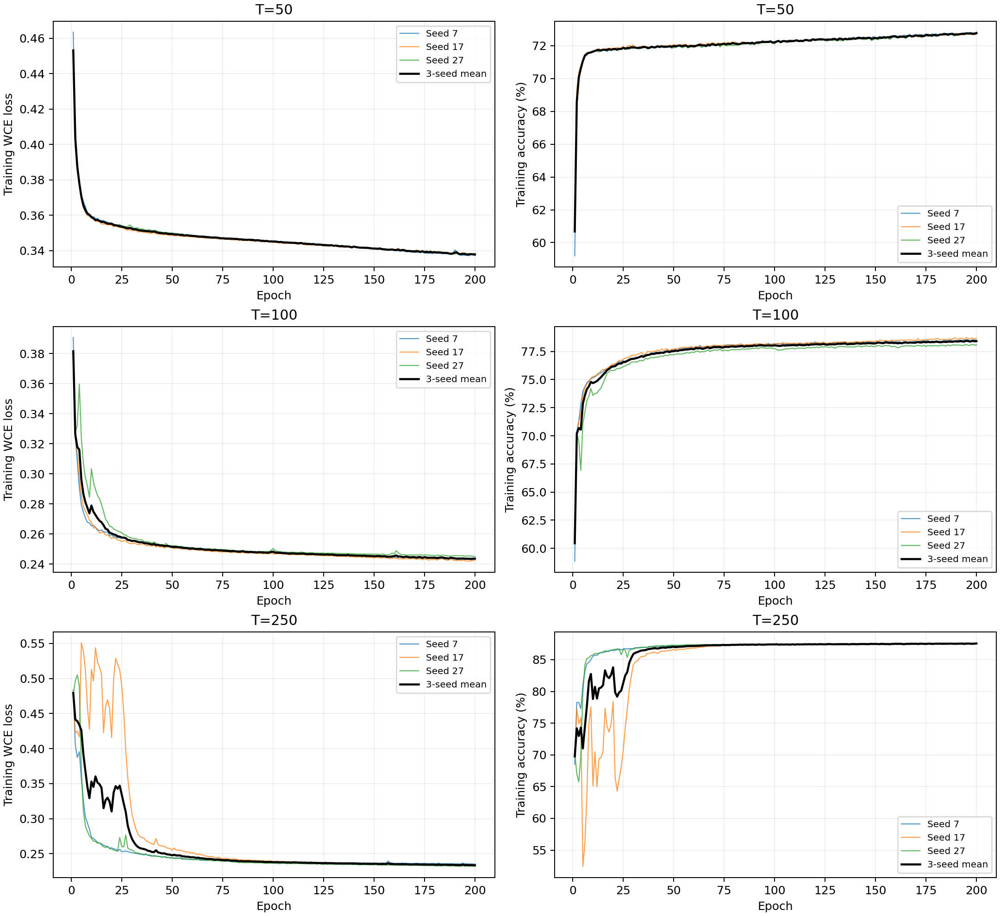
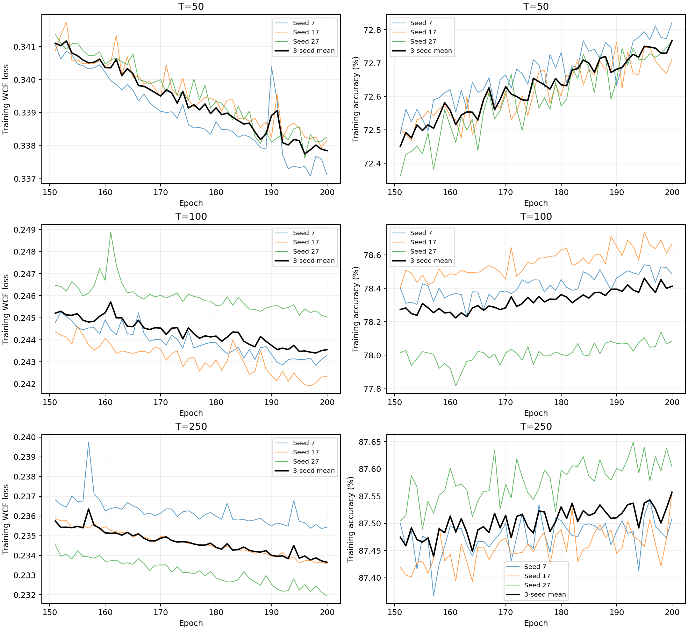

# Official LSTM checkpoint 학습 history 분석

## 판단 요약

200 epoch에서 완전히 평탄한 optimization plateau에 도달했다고 판단할 근거는 없다. 9개 run 모두 마지막 50 epoch 및 마지막 20 epoch의 loss slope가 음수이며, 첫/마지막 10-epoch block 비교에서도 모두 감소한다. 느리지만 방향이 일관된 후반부 학습이 남아 있다. 개선량이 작다는 것과 수렴 완료는 구분해야 한다.

- T=50: 평균 150→200 loss 감소 0.00334469 (0.9803%), accuracy +0.2961 pp. 마지막 50 epoch 평균 slope −6.69094e−5, R²=0.9609. 세 seed에서 감소 추세가 뚜렷하다.
- T=100: 평균 150→200 loss 감소 0.00157966 (0.6444%), accuracy +0.1925 pp. 마지막 50 epoch 평균 slope −3.87894e−5, R²=0.8911. 100→150보다 loss 감소가 느려졌지만 평탄하지 않다.
- T=250: 평균 150→200 loss 감소 0.00200808 (0.8521%), accuracy +0.0703 pp. 마지막 50 epoch 평균 slope −3.92084e−5, R²=0.9031. Accuracy는 실용적으로 거의 plateau에 가깝지만 WCE loss는 계속 감소한다. Confidence 변화가 argmax accuracy 변화 없이 loss를 낮출 수 있으나, 그 세부 원인은 history만으로 확정할 수 없다.

마지막 20 epoch의 평균 trajectory OLS fitted loss 감소율은 T50=0.3426%, T100=0.3218%, T250=0.2997%다. 같은 기간 첫 10 vs 마지막 10 epoch의 평균 accuracy 변화는 각각 +0.0445/+0.0484/+0.0094 pp로 작다. 임의의 flatness 허용오차를 사후 설정하지 않았으며, 위 판정은 기술적 추세 판단이지 slope의 유의성 검정이 아니다.

기존 기록으로 'epoch 200에도 loss 감소가 남아 있는가'는 판단할 수 있으므로, 이 질문에 답하기 위해 추가 epoch 실험을 제안하지 않는다. 다만 200 이후 총 개선 폭, 최종 수렴 epoch, gradient stationary point 도달 여부는 이 기록만으로 판단할 수 없다. 이를 현재 결과의 개선 보장이나 official test 결과 변경 근거로 해석하지 않는다.

대상: T50/w2=.55625, T100/w2=.425, T250/w2=.74375; seeds 7/17/27. 기존 history 1–200만 분석. 새 학습·calibration·test 평가는 수행하지 않음.

구간 loss 감소량 = loss(start) − loss(end); relative decrease = 감소량/loss(start) × 100. Accuracy 변화는 percentage points. 음의 감소량은 악화.

마지막 50 epoch는 151–200, 마지막 20 epoch는 181–200. OLS slope는 loss/epoch 단위이며 fitted 감소량은 −slope × (n−1). R²와 residual SD는 기술 통계이며 serial correlation을 무시한 유의성 검정은 하지 않음. 첫/마지막 10-epoch 평균 비교로 단일 endpoint 변동을 보완.

기록된 loss/accuracy는 epoch 동안 계속 갱신되는 모델의 shuffled training minibatch 평균이다. 고정 checkpoint를 전체 training set에서 재평가한 값이나 gradient norm이 아니다. WCE weight가 T마다 달라 T 간 loss 절대값 비교에는 의미를 부여하지 않음.

## Seed별 및 평균 learning curves

## 지정 epoch 값

| T | seed | epoch | loss | accuracy_percent |
| --- | --- | --- | --- | --- |
| 50 | 17 | 100 | 0.3445801 | 72.2075 |
| 50 | 17 | 125 | 0.3426667 | 72.36833 |
| 50 | 17 | 150 | 0.3409475 | 72.46667 |
| 50 | 17 | 175 | 0.3393985 | 72.61083 |
| 50 | 17 | 200 | 0.3381673 | 72.71167 |
| 50 | 27 | 100 | 0.3454105 | 72.1175 |
| 50 | 27 | 125 | 0.3433243 | 72.32833 |
| 50 | 27 | 150 | 0.3414634 | 72.45 |
| 50 | 27 | 175 | 0.3393778 | 72.64333 |
| 50 | 27 | 200 | 0.3382635 | 72.76667 |
| 50 | 7 | 100 | 0.3453926 | 72.26167 |
| 50 | 7 | 125 | 0.34335 | 72.37917 |
| 50 | 7 | 150 | 0.3411671 | 72.49583 |
| 50 | 7 | 175 | 0.3386421 | 72.71 |
| 50 | 7 | 200 | 0.3371132 | 72.8225 |
| 50 | mean | 100 | 0.3451277 | 72.19556 |
| 50 | mean | 125 | 0.3431137 | 72.35861 |
| 50 | mean | 150 | 0.3411927 | 72.47083 |
| 50 | mean | 175 | 0.3391395 | 72.65472 |
| 50 | mean | 200 | 0.337848 | 72.76694 |
| 100 | 17 | 100 | 0.2468383 | 78.17417 |
| 100 | 17 | 125 | 0.2454595 | 78.26167 |
| 100 | 17 | 150 | 0.2440527 | 78.43167 |
| 100 | 17 | 175 | 0.243146 | 78.545 |
| 100 | 17 | 200 | 0.2423396 | 78.66667 |
| 100 | 27 | 100 | 0.2502814 | 77.7675 |
| 100 | 27 | 125 | 0.2471737 | 77.92333 |
| 100 | 27 | 150 | 0.2464734 | 77.955 |
| 100 | 27 | 175 | 0.2460771 | 77.94333 |
| 100 | 27 | 200 | 0.2450313 | 78.08583 |
| 100 | 7 | 100 | 0.2475173 | 78.18917 |
| 100 | 7 | 125 | 0.2461868 | 78.20667 |
| 100 | 7 | 150 | 0.2448767 | 78.27417 |
| 100 | 7 | 175 | 0.2444048 | 78.45083 |
| 100 | 7 | 200 | 0.2432929 | 78.48583 |
| 100 | mean | 100 | 0.2482123 | 78.04361 |
| 100 | mean | 125 | 0.2462733 | 78.13056 |
| 100 | mean | 150 | 0.2451342 | 78.22028 |
| 100 | mean | 175 | 0.2445426 | 78.31306 |
| 100 | mean | 200 | 0.2435546 | 78.41278 |
| 250 | 17 | 100 | 0.2390438 | 87.3375 |
| 250 | 17 | 125 | 0.2371262 | 87.37167 |
| 250 | 17 | 150 | 0.2358148 | 87.41333 |
| 250 | 17 | 175 | 0.2345944 | 87.44833 |
| 250 | 17 | 200 | 0.233572 | 87.55833 |
| 250 | 27 | 100 | 0.2365762 | 87.405 |
| 250 | 27 | 125 | 0.2350272 | 87.47583 |
| 250 | 27 | 150 | 0.2343798 | 87.55833 |
| 250 | 27 | 175 | 0.2331457 | 87.54333 |
| 250 | 27 | 200 | 0.2319454 | 87.60417 |
| 250 | 7 | 100 | 0.2382657 | 87.46 |
| 250 | 7 | 125 | 0.2375574 | 87.40417 |
| 250 | 7 | 150 | 0.236777 | 87.48917 |
| 250 | 7 | 175 | 0.2362621 | 87.45417 |
| 250 | 7 | 200 | 0.2354299 | 87.50917 |
| 250 | mean | 100 | 0.2379619 | 87.40083 |
| 250 | mean | 125 | 0.2365703 | 87.41722 |
| 250 | mean | 150 | 0.2356572 | 87.48694 |
| 250 | mean | 175 | 0.2346674 | 87.48194 |
| 250 | mean | 200 | 0.2336491 | 87.55722 |

## 구간별 변화

| T | seed | start | end | loss_decrease | relative_decrease_percent | accuracy_change_pp |
| --- | --- | --- | --- | --- | --- | --- |
| 50 | 17 | 100 | 150 | 0.003632579 | 1.054205 | 0.2591667 |
| 50 | 17 | 150 | 200 | 0.002780253 | 0.8154489 | 0.245 |
| 50 | 17 | 175 | 200 | 0.001231194 | 0.3627578 | 0.1008333 |
| 50 | 27 | 100 | 150 | 0.003947104 | 1.142729 | 0.3325 |
| 50 | 27 | 150 | 200 | 0.003199912 | 0.9371171 | 0.3166667 |
| 50 | 27 | 175 | 200 | 0.001114349 | 0.3283504 | 0.1233333 |
| 50 | 7 | 100 | 150 | 0.00422544 | 1.223373 | 0.2341667 |
| 50 | 7 | 150 | 200 | 0.004053892 | 1.188242 | 0.3266667 |
| 50 | 7 | 175 | 200 | 0.001528867 | 0.4514699 | 0.1125 |
| 50 | mean | 100 | 150 | 0.003935041 | 1.14017 | 0.2752778 |
| 50 | mean | 150 | 200 | 0.003344685 | 0.9802923 | 0.2961111 |
| 50 | mean | 175 | 200 | 0.00129147 | 0.380808 | 0.1122222 |
| 100 | 17 | 100 | 150 | 0.002785605 | 1.128514 | 0.2575 |
| 100 | 17 | 150 | 200 | 0.001713085 | 0.7019324 | 0.235 |
| 100 | 17 | 175 | 200 | 0.00080643 | 0.3316649 | 0.1216667 |
| 100 | 27 | 100 | 150 | 0.003808064 | 1.521513 | 0.1875 |
| 100 | 27 | 150 | 200 | 0.001442068 | 0.5850807 | 0.1308333 |
| 100 | 27 | 175 | 200 | 0.001045799 | 0.4249882 | 0.1425 |
| 100 | 7 | 100 | 150 | 0.002640629 | 1.066846 | 0.085 |
| 100 | 7 | 150 | 200 | 0.001583813 | 0.6467799 | 0.2116667 |
| 100 | 7 | 175 | 200 | 0.00111193 | 0.4549541 | 0.035 |
| 100 | mean | 100 | 150 | 0.0030781 | 1.240107 | 0.1766667 |
| 100 | mean | 150 | 200 | 0.001579655 | 0.6444042 | 0.1925 |
| 100 | mean | 175 | 200 | 0.0009880528 | 0.4040411 | 0.09972222 |
| 250 | 17 | 100 | 150 | 0.003228971 | 1.350787 | 0.07583333 |
| 250 | 17 | 150 | 200 | 0.002242766 | 0.9510709 | 0.145 |
| 250 | 17 | 175 | 200 | 0.001022392 | 0.4358126 | 0.11 |
| 250 | 27 | 100 | 150 | 0.00219641 | 0.9284156 | 0.1533333 |
| 250 | 27 | 150 | 200 | 0.00243438 | 1.038647 | 0.04583333 |
| 250 | 27 | 175 | 200 | 0.00120028 | 0.5148197 | 0.06083333 |
| 250 | 7 | 100 | 150 | 0.001488671 | 0.6247946 | 0.02916667 |
| 250 | 7 | 150 | 200 | 0.00134709 | 0.5689278 | 0.02 |
| 250 | 7 | 175 | 200 | 0.0008322108 | 0.3522405 | 0.055 |
| 250 | mean | 100 | 150 | 0.002304684 | 0.9685098 | 0.08611111 |
| 250 | mean | 150 | 200 | 0.002008079 | 0.8521185 | 0.07027778 |
| 250 | mean | 175 | 200 | 0.001018294 | 0.4339309 | 0.07527778 |

## 후반 loss 추세

| T | seed | last_n | first_epoch | last_epoch | loss_slope_per_epoch | fitted_loss_decrease | fitted_relative_decrease_percent | r_squared | residual_sd | first10_mean_loss | last10_mean_loss | block_relative_decrease_percent | block_accuracy_change_pp |
| --- | --- | --- | --- | --- | --- | --- | --- | --- | --- | --- | --- | --- | --- |
| 50 | 17 | 20 | 181 | 200 | -5.643293e-05 | 0.001072226 | 0.3166175 | 0.5561784 | 0.000306411 | 0.3388561 | 0.3384442 | 0.1215643 | 0.01175 |
| 50 | 17 | 50 | 151 | 200 | -6.141646e-05 | 0.003009407 | 0.8862512 | 0.8872758 | 0.0003224192 | 0.3407548 | 0.3384442 | 0.6780976 | 0.1658333 |
| 50 | 27 | 20 | 181 | 200 | -5.399148e-05 | 0.001025838 | 0.3030828 | 0.5353802 | 0.0003057155 | 0.3387064 | 0.3382295 | 0.1408093 | 0.06516667 |
| 50 | 27 | 50 | 151 | 200 | -6.968089e-05 | 0.003414364 | 1.005571 | 0.9411394 | 0.0002566587 | 0.3409226 | 0.3382295 | 0.7899419 | 0.277 |
| 50 | 7 | 20 | 181 | 200 | -7.264814e-05 | 0.001380315 | 0.4083426 | 0.2893065 | 0.0006920877 | 0.3384617 | 0.3375955 | 0.2558977 | 0.05666667 |
| 50 | 7 | 50 | 151 | 200 | -6.963097e-05 | 0.003411918 | 1.006526 | 0.8274073 | 0.0004683935 | 0.340553 | 0.3375955 | 0.8684153 | 0.2098333 |
| 50 | mean | 20 | 181 | 200 | -6.102418e-05 | 0.001159459 | 0.3426479 | 0.6863446 | 0.0002507447 | 0.3386747 | 0.3380897 | 0.1727295 | 0.04452778 |
| 50 | mean | 50 | 151 | 200 | -6.690944e-05 | 0.003278563 | 0.9660919 | 0.9608998 | 0.0001987902 | 0.3407434 | 0.3380897 | 0.7788024 | 0.2175556 |
| 100 | 17 | 20 | 181 | 200 | -6.614733e-05 | 0.001256799 | 0.5180722 | 0.493911 | 0.0004069828 | 0.2429674 | 0.2422157 | 0.3093782 | 0.05383333 |
| 100 | 17 | 50 | 151 | 200 | -4.181004e-05 | 0.002048692 | 0.8425344 | 0.7761666 | 0.0003306911 | 0.2440452 | 0.2422157 | 0.7496508 | 0.1854167 |
| 100 | 27 | 20 | 181 | 200 | -3.025937e-05 | 0.0005749281 | 0.2342366 | 0.5610384 | 0.0001626865 | 0.2455704 | 0.2453248 | 0.1000023 | 0.03416667 |
| 100 | 27 | 50 | 151 | 200 | -3.33702e-05 | 0.00163514 | 0.6648348 | 0.543983 | 0.0004500012 | 0.2464618 | 0.2453248 | 0.4613367 | 0.09366667 |
| 100 | 7 | 20 | 181 | 200 | -2.744656e-05 | 0.0005214847 | 0.2143645 | 0.3755894 | 0.0002151003 | 0.243466 | 0.2430742 | 0.1609403 | 0.05733333 |
| 100 | 7 | 50 | 151 | 200 | -4.118799e-05 | 0.002018211 | 0.8274609 | 0.8363472 | 0.0002683464 | 0.2447235 | 0.2430742 | 0.6739403 | 0.1415 |
| 100 | mean | 20 | 181 | 200 | -4.128442e-05 | 0.000784404 | 0.3217807 | 0.6843919 | 0.000170405 | 0.2440013 | 0.2435382 | 0.1897666 | 0.04844444 |
| 100 | mean | 50 | 151 | 200 | -3.878941e-05 | 0.001900681 | 0.7778952 | 0.8911194 | 0.0001996997 | 0.2450768 | 0.2435382 | 0.6278025 | 0.1401944 |
| 250 | 17 | 20 | 181 | 200 | -4.48556e-05 | 0.0008522564 | 0.3642162 | 0.9077871 | 8.689507e-05 | 0.234217 | 0.2337778 | 0.1875155 | 0.008333333 |
| 250 | 17 | 50 | 151 | 200 | -4.369409e-05 | 0.00214101 | 0.9124798 | 0.9766865 | 9.942724e-05 | 0.2355522 | 0.2337778 | 0.7533173 | 0.04891667 |
| 250 | 27 | 20 | 181 | 200 | -3.824681e-05 | 0.0007266894 | 0.3125234 | 0.4974052 | 0.0002336811 | 0.2327519 | 0.2322945 | 0.1964952 | 0.01633333 |
| 250 | 27 | 50 | 151 | 200 | -4.219787e-05 | 0.002067696 | 0.8868065 | 0.9185968 | 0.0001850145 | 0.2340048 | 0.2322945 | 0.7308793 | 0.07016667 |
| 250 | 7 | 20 | 181 | 200 | -2.767848e-05 | 0.0005258911 | 0.2230638 | 0.2021449 | 0.0003342315 | 0.2358562 | 0.2356602 | 0.08311919 | 0.003583333 |
| 250 | 7 | 50 | 151 | 200 | -3.173322e-05 | 0.001554928 | 0.6583155 | 0.458355 | 0.0005080746 | 0.2370278 | 0.2356602 | 0.5769712 | 0.03525 |
| 250 | mean | 20 | 181 | 200 | -3.692696e-05 | 0.0007016123 | 0.2997153 | 0.6577404 | 0.0001619082 | 0.234275 | 0.2339108 | 0.1554556 | 0.009416667 |
| 250 | mean | 50 | 151 | 200 | -3.920839e-05 | 0.001921211 | 0.8187021 | 0.9030535 | 0.0001892106 | 0.2355283 | 0.2339108 | 0.6867301 | 0.05144444 |
