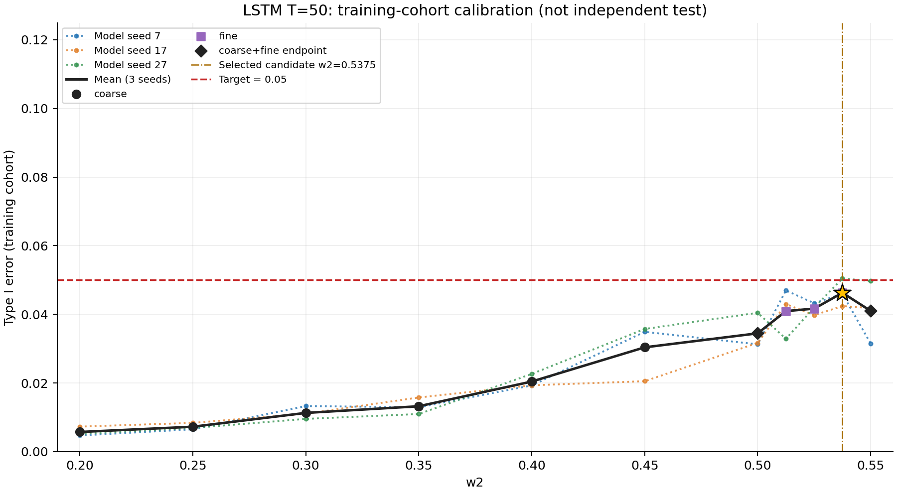
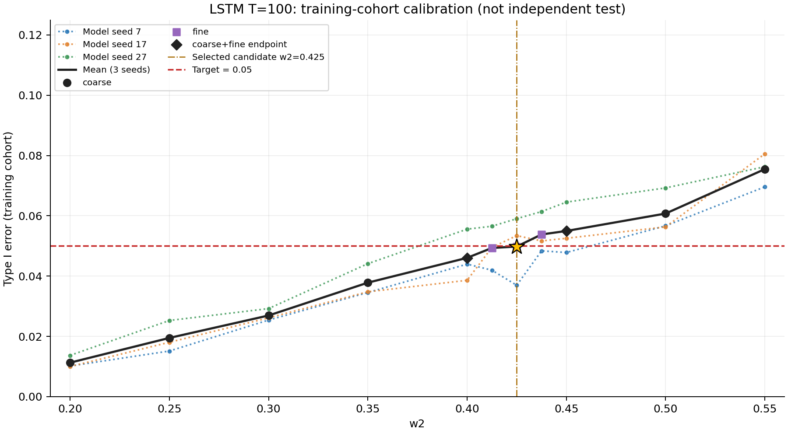
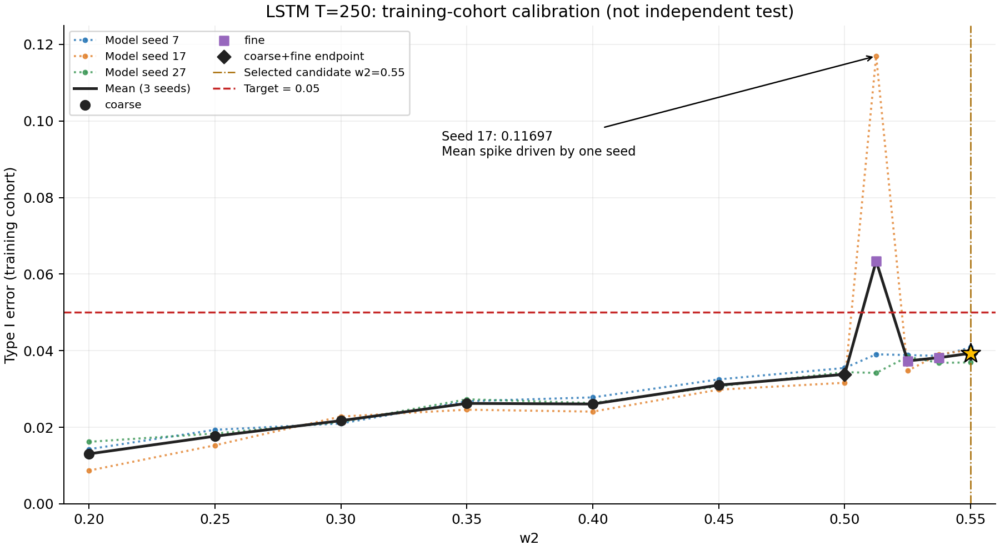
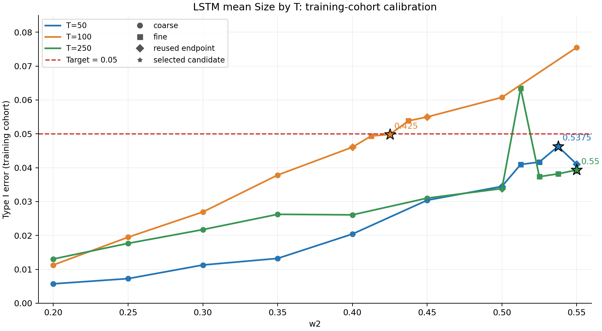

# LSTM w2 calibration 안정성 분석

분석일: 2026-10-14 (Asia/Seoul). 모든 Size와 Power는 **training-cohort calibration** 결과이며 independent test 결과가 아니다. 새 학습, calibration, 모델 추론, independent test는 실행하지 않았다. 기존 코드·체크포인트·calibration 파일을 변경하지 않았다.

## 자료와 집계 검증

원본: `results/lstm_paper2019_extension/w2_calibration/`. 실제 실행 record 99개(coarse 72, 신규 fine 27)를 확인했다. fine_records에는 45개가 있지만 coarse에서 재사용한 endpoint 18개를 포함한다. `(T,w2,model_seed)`를 키로 중복을 제거해 T별 11개 w2 × 3 seeds = 33개, 총 99개만 집계했다. endpoint는 coarse+fine으로 표시하지만 한 번만 계산한다.

seed는 7/17/27, 각 fit은 200 epochs이고 T별 동일 fingerprint의 학습 데이터를 재사용한다. 각 T의 120,000개 중 귀무가설 60,000개에서 Size, 대립가설 60,000개에서 Power를 계산했다. rho-beta 셀별 저장 rejection rate의 가중 평균을 record metrics와 대조했고, coarse/fine summary 및 후보 통계와도 일치했다. SD는 seed 3개의 표본 표준편차(ddof=1)다. 서로 다른 학습데이터 표본에 대한 변동이나 독립 평가의 표준오차가 아니다.

저장된 선택값은 `final:false`인 잠정 fine_grid_candidate다. 그래프의 별은 현재 선택 후보를 의미하며, 검증된 최종 모델을 의미하지 않는다. 선택 규칙은 fine grid에서 `|평균 Size−0.05|` 최소, 동률이면 작은 w2다. 이 후보들은 coarse+fine 전체에서도 가장 가깝다. Power와 SD는 선택 목적함수에 포함되지 않는다.

## 판단

- **T=50:** 전반적 증가지만 비단조. 전체 평균이 0.05 미만이므로 평균 bracket 없음. 0.5375의 평균 0.046289가 가장 가깝고, 0.55에서는 오히려 0.041017로 하락한다. 0.5375보다 큰 값이 필요할 가능성은 있지만 단순히 조금 올리면 개선된다고 할 근거는 없다. 향후 범위를 확장한다면 기존 상한 0.55보다 위를 확인하는 방향이며, 동시에 seed 변동을 확인해야 한다. seed 7/17은 전 범위에서 0.05 미만, seed 27만 0.525–0.5375 및 0.5375–0.55에서 교차한다. 즉 범위 부족 가능성과 학습 변동이 함께 있다.
- **T=100:** 평균은 모든 인접점에서 증가하고, coarse [0.4,0.45], 전체 fine 포함 [0.425,0.4375]에서 실제 bracket한다. 그러나 선택 0.425의 seed Size는 0.036967/0.053433/0.059050, SD 0.011477, 범위 0.022083(2.2083 percentage points)다. 평균 0.049817은 정확하지만 seed별 안정성은 낮다. seed별 교차 구간도 각각 [0.45,0.5], [0.4125,0.425], [0.35,0.4]로 다르다. 탐색 상한 확대보다 이미 bracket된 0.4–0.45 주변에서 학습 seed 재현성 확인을 우선할 근거가 크다. 이미 관측한 0.4125는 평균 0.049344, SD 0.007293으로 후보보다 평균 오차는 조금 크지만 변동은 작다. 이것만으로 새 최종값을 확정하지 않는다.
- **T=250:** 전반적 증가지만 0.35→0.4의 작은 하락과 0.5125의 큰 spike가 있어 비단조다. coarse에서는 bracket 없음. fine 포함 평균은 [0.5,0.5125]와 [0.5125,0.525]에서 **수치적으로 bracket한다**. 그러나 두 교차 모두 0.5125 seed 17의 Size 0.116967이 만든 것으로, seed 7/27은 전 범위에서 0.05 미만이다. 따라서 안정적인 목표 bracket이라고 해석하기 어렵다.
- **T=250의 0.55 선택 이유:** 평균 0.039344, 목표와 거리 0.010656으로 가장 가깝다. spike의 평균 0.063417은 목표와 거리 0.013417이므로 선택되지 않는다. 0.55의 seed Size는 0.040850/0.040233/0.036950, SD 0.002096으로 모두 보수적이다. 평균 Power 0.782367이 최대라서 선택된 것은 아니다(0.5375의 Power 0.783689가 더 높다). 안정적으로 관측된 쪽이 상한에서도 0.05 미만이므로 향후 **0.55 초과 상한 확장**의 근거가 가장 강하다. 동시에 0.5125의 seed 이상 변동을 별도 확인해야 한다.

위 추가 탐색 방향은 기존 결과에 따른 제안이며, 이번 작업에서는 실행하지 않았다. 세 seed만으로 더 큰 w2에서 반드시 목표에 도달한다고 보장하거나, 학습 불안정의 정확한 원인을 확정할 수 없다.

## T=250 spike: 저장 지표에 따른 학습 변동 근거

동일 w2=0.5125, 동일 training fingerprint에서 seed 7/17/27의 Size는 0.039067/0.116967/0.034217이고 SD는 0.046439(4.6439 percentage points), 범위는 0.082750(8.2750 percentage points)이다. seed 17의 Power는 0.630217로 다른 두 seed 0.783867/0.777433보다 낮고, 최종 평가 loss는 0.326470으로 다른 두 seed 0.188292/0.187736보다 높다. seed 17은 beta별 Size도 모두 0.1076–0.1296으로 높아 특정 beta 하나에 국한되지 않는다. 저장 history의 epoch 200 loss 0.326825, accuracy 0.752858 역시 열화된 fit과 일관된다. 이는 단순한 w2 범위 부족과 구별되는 seed별 학습 경로 변동의 증거다. 초기화, shuffle, MPS 등의 개별 원인은 이 자료로 분리할 수 없다.

원본 spike를 제거하거나 보정하지 않았다. 설명용 민감도 계산에서 이 한 seed를 제외하면 해당 w2의 나머지 두 seed 평균은 0.036642로 0.05 미만이다. 다른 w2 평균도 모두 0.05 미만이므로 이 spike 없이 평균 교차는 없다. 이 계산은 이상값 제거 후 새 calibration 결과가 아니라 교차 원인을 설명하는 보조 계산이다.

## 같은 w2에서 seed 간 변동

- T=50: w2별 SD 평균 0.004046, 중앙값 0.002422; 최대 0.009129 (w2=0.55). 선택 후보 SD 0.004034, seed 범위 0.008050. 평균 곡선 하락 구간: [(0.5375, 0.55)].
- T=100: w2별 SD 평균 0.006410, 중앙값 0.006776; 최대 0.011477 (w2=0.425). 선택 후보 SD 0.011477, seed 범위 0.022083. 평균 곡선 하락 구간: 없음.
- T=250: w2별 SD 평균 0.005967, 중앙값 0.001992; 최대 0.046439 (w2=0.5125). 선택 후보 SD 0.002096, seed 범위 0.003900. 평균 곡선 하락 구간: [(0.35, 0.4), (0.5125, 0.525)].

SD 요약은 관측 w2들을 동일 가중한 기술통계이며 grid 밀도에 영향을 받는다. T=250은 한 spike가 평균 SD를 크게 높이므로 중앙값도 함께 봐야 한다. spike 이외 10개 w2의 평균 SD는 0.001919이다. T=100은 비교적 지속적인 seed 변동, T=250은 대체로 작은 변동에 한 번의 매우 큰 학습 변동이 섞인 양상이다. seed별 선을 연결한 그래프는 관측점을 보여주는 것이며, 그 사이의 단조성이나 원인을 증명하지 않는다.

## ANN 비교 가능 여부

동일 fixed-200 ANN 결과의 예정 경로 `results/ann_paper2019_reproduction/w2_calibration/`는 로컬에 없다. results 전체에서 ANN calibration_record/coarse_summary/fine_summary도 발견하지 못했다. ANN smoke 결과는 존재하지만 예를 들어 ann_sweep_smoke는 training 240개, 2 epochs, data seeds 42/43, hidden size 20, val/test 기반이고 smoke_ann_50은 3 epochs다. LSTM의 training 120,000개, 200 epochs, data seed 20191007 조건과 다르다. 따라서 동일 형식의 ANN 곡선과 어느 모델이 더 불안정한지에 대한 비교는 제공할 수 없다. 이번 분석에서 ANN evaluation_test 파일은 읽거나 실행하지 않았다.

## 전체 표와 그래프

모든 값은 비율 단위다(0.05=5%). coarse+fine endpoint는 재사용한 하나의 실험이다. CSV는 소수점을 줄이지 않은 집계값을 담는다.

### T=50

| w2 | 단계 | Seed 7 Size | Seed 17 Size | Seed 27 Size | 평균 Size | 표본 SD | 평균 Power |
|---:|:---|---:|---:|---:|---:|---:|---:|
| 0.2 | coarse | 0.004717 | 0.007300 | 0.005200 | 0.005739 | 0.001373 | 0.405589 |
| 0.25 | coarse | 0.006517 | 0.008383 | 0.006900 | 0.007267 | 0.000986 | 0.408922 |
| 0.3 | coarse | 0.013283 | 0.011050 | 0.009550 | 0.011294 | 0.001879 | 0.424967 |
| 0.35 | coarse | 0.012933 | 0.015783 | 0.010967 | 0.013228 | 0.002422 | 0.430000 |
| 0.4 | coarse | 0.019300 | 0.019333 | 0.022650 | 0.020428 | 0.001925 | 0.449617 |
| 0.45 | coarse | 0.034917 | 0.020533 | 0.035750 | 0.030400 | 0.008555 | 0.475167 |
| 0.5 | coarse+fine endpoint | 0.031283 | 0.031700 | 0.040467 | 0.034483 | 0.005186 | 0.481544 |
| 0.5125 | fine | 0.046983 | 0.043000 | 0.032883 | 0.040956 | 0.007269 | 0.492550 |
| 0.525 | fine | 0.043250 | 0.039783 | 0.041983 | 0.041672 | 0.001754 | 0.497756 |
| 0.5375 | fine | 0.045983 | 0.042417 | 0.050467 | 0.046289 | 0.004034 | 0.503894 |
| 0.55 | coarse+fine endpoint | 0.031500 | 0.041850 | 0.049700 | 0.041017 | 0.009129 | 0.489711 |

### T=100

| w2 | 단계 | Seed 7 Size | Seed 17 Size | Seed 27 Size | 평균 Size | 표본 SD | 평균 Power |
|---:|:---|---:|---:|---:|---:|---:|---:|
| 0.2 | coarse | 0.010183 | 0.010000 | 0.013700 | 0.011294 | 0.002085 | 0.494800 |
| 0.25 | coarse | 0.015150 | 0.018050 | 0.025283 | 0.019494 | 0.005219 | 0.530183 |
| 0.3 | coarse | 0.025433 | 0.026150 | 0.029233 | 0.026939 | 0.002019 | 0.554367 |
| 0.35 | coarse | 0.034567 | 0.034800 | 0.044133 | 0.037833 | 0.005457 | 0.592633 |
| 0.4 | coarse+fine endpoint | 0.043983 | 0.038617 | 0.055583 | 0.046061 | 0.008672 | 0.606456 |
| 0.4125 | fine | 0.041967 | 0.049517 | 0.056550 | 0.049344 | 0.007293 | 0.621961 |
| 0.425 | fine | 0.036967 | 0.053433 | 0.059050 | 0.049817 | 0.011477 | 0.618828 |
| 0.4375 | fine | 0.048383 | 0.051683 | 0.061417 | 0.053828 | 0.006776 | 0.627467 |
| 0.45 | coarse+fine endpoint | 0.047833 | 0.052550 | 0.064550 | 0.054978 | 0.008619 | 0.628300 |
| 0.5 | coarse | 0.056683 | 0.056333 | 0.069267 | 0.060761 | 0.007368 | 0.644033 |
| 0.55 | coarse | 0.069617 | 0.080567 | 0.076300 | 0.075494 | 0.005519 | 0.672200 |

### T=250

| w2 | 단계 | Seed 7 Size | Seed 17 Size | Seed 27 Size | 평균 Size | 표본 SD | 평균 Power |
|---:|:---|---:|---:|---:|---:|---:|---:|
| 0.2 | coarse | 0.014283 | 0.008700 | 0.016217 | 0.013067 | 0.003903 | 0.703389 |
| 0.25 | coarse | 0.019350 | 0.015300 | 0.018383 | 0.017678 | 0.002115 | 0.730106 |
| 0.3 | coarse | 0.021000 | 0.022817 | 0.021383 | 0.021733 | 0.000958 | 0.744511 |
| 0.35 | coarse | 0.026817 | 0.024600 | 0.027317 | 0.026244 | 0.001446 | 0.757600 |
| 0.4 | coarse | 0.027817 | 0.024100 | 0.026350 | 0.026089 | 0.001872 | 0.756489 |
| 0.45 | coarse | 0.032517 | 0.029833 | 0.030717 | 0.031022 | 0.001368 | 0.768556 |
| 0.5 | coarse+fine endpoint | 0.035500 | 0.031633 | 0.034400 | 0.033844 | 0.001992 | 0.774678 |
| 0.5125 | fine | 0.039067 | 0.116967 | 0.034217 | 0.063417 | 0.046439 | 0.730506 |
| 0.525 | fine | 0.038867 | 0.034767 | 0.038417 | 0.037350 | 0.002249 | 0.780944 |
| 0.5375 | fine | 0.038650 | 0.039083 | 0.036833 | 0.038189 | 0.001194 | 0.783689 |
| 0.55 | coarse+fine endpoint | 0.040850 | 0.040233 | 0.036950 | 0.039344 | 0.002096 | 0.782367 |

### 세 T 평균 비교

## 출력 및 보존 확인

`w2_size_full.csv`, 개별 그래프 3개, 평균 비교 그래프 1개, 본 분석 보고서만 별도 출력했다. 기존 JSON/CSV 및 scripts/configs 내용의 SHA-256을 분석 전후 대조했고, calibration checkpoint의 파일 크기와 수정 시각도 동일함을 확인했다.
